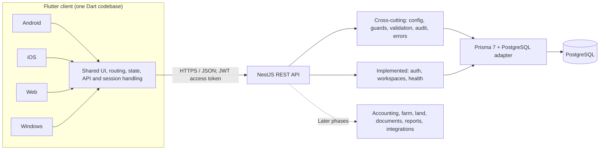
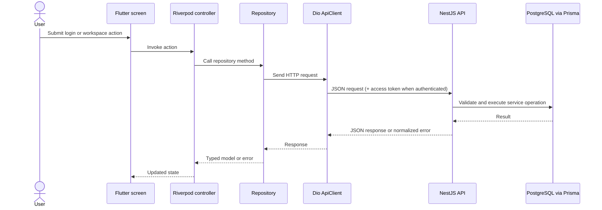
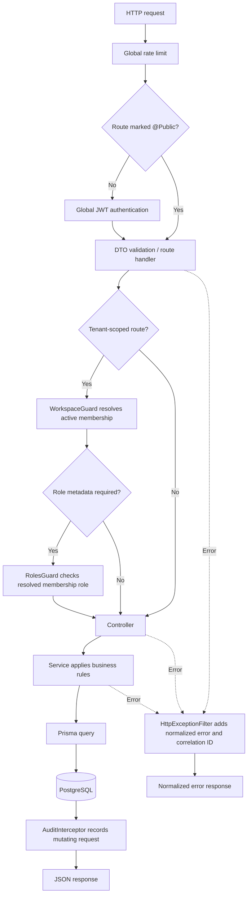
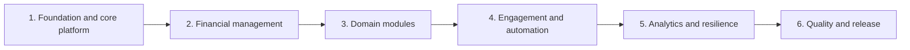

# Tangent Smart Manager

Tangent Smart Manager is a multi-tenant financial and business management platform for Android, iOS, Web, and Windows. The long-term product scope includes personal and household finances, business records, land management, inventory, and goat-farm management.

The repository currently contains a Flutter client and a NestJS API backed by PostgreSQL. Development is phase-based; the existence of a planned module in a design document does not mean that module is implemented. **Use [IMPLEMENTATION_STATUS.md](IMPLEMENTATION_STATUS.md) as the source of truth for what has actually been built and verified.**

## Start here

Before making a change:

1. Read [IMPLEMENTATION_STATUS.md](IMPLEMENTATION_STATUS.md) for verified functionality and blockers.
2. Read [PHASES.md](PHASES.md) for the six delivery groups, and [WORKFLOW.md](WORKFLOW.md) for the repository's development process.
3. Check [DECISIONS.md](DECISIONS.md) before changing an architectural choice.
4. Trace the existing code path before assuming the documentation describes current behavior.

## System at a glance





The second diagram shows the usual feature path. Auth restoration, refresh-token retries, and workspace selection add steps described in [Client request and session flow](#client-request-and-session-flow).

## Repository structure

```text
.
├── app/                         Flutter application
│   ├── lib/
│   │   ├── core/
│   │   │   ├── api/             Dio client and secure token storage
│   │   │   ├── auth/            Auth models, repository, Riverpod controller
│   │   │   ├── router/          go_router setup and auth/workspace redirects
│   │   │   ├── theme/           Theme, colors, reusable UI
│   │   │   └── workspace/       Workspace models, repository, controller
│   │   ├── features/
│   │   │   ├── auth/            Login UI
│   │   │   ├── dashboard/       Dashboard UI
│   │   │   ├── shell/           App shell, navigation, planned-module screens
│   │   │   └── workspace/       Workspace creation UI
│   │   └── main.dart            Flutter entry point
│   └── test/                    Flutter widget tests
├── backend/
│   ├── prisma/
│   │   └── schema.prisma        PostgreSQL data model
│   ├── src/
│   │   ├── common/              Guards, decorators, audit, errors, money, crypto
│   │   ├── config/              Runtime configuration and environment validation
│   │   ├── modules/
│   │   │   ├── auth/            Registration, login, refresh, logout, profile
│   │   │   ├── health/          Health endpoint
│   │   │   └── workspaces/      Tenant creation, listing, access and invitations
│   │   ├── prisma/              Prisma module, service and seed
│   │   ├── app.module.ts        Root module and global providers
│   │   └── main.ts              HTTP bootstrap and global middleware
│   ├── test/                    End-to-end test files
│   └── package.json             Backend scripts and dependencies
├── *.md                         Architecture, requirements, delivery and module docs
└── Tangent Smart Manager Dashboard.png
```

The tree intentionally reflects the current implementation, not the eventual target. Backend domain modules such as accounting, goat farm, land, AI, and notifications are planned; consult [FEATURES.md](FEATURES.md) and [IMPLEMENTATION_STATUS.md](IMPLEMENTATION_STATUS.md) before working on one. Flutter currently organizes shared infrastructure under `core/` and screens by feature; do not assume every feature already has separate `data/`, `domain/`, and `presentation/` layers.

## Architecture and technologies

### Flutter client

- **Flutter / Dart** provide the shared application and platform UI.
- **Riverpod** manages authentication and workspace state and exposes dependencies.
- **go_router** maps routes and redirects users based on session and workspace state.
- **Dio** is the shared HTTP client. `ApiClient` centralizes the API base URL, access-token handling, refresh-and-retry behavior, and token persistence.
- **flutter_secure_storage** backs the token storage abstraction.
- **intl** and Flutter localization packages support the English/Urdu localization direction.

The app entry point creates a `ProviderScope`, then `MaterialApp.router` obtains its router from Riverpod. English and Urdu locales are registered. Locale registration alone is not proof that every screen is translated or that Urdu right-to-left behavior has been fully verified; check project status before treating localization as complete.

### NestJS backend

- **NestJS 12 / TypeScript 6 (ES modules)** structure the HTTP API into modules, controllers, and injectable services.
- **class-validator / class-transformer** validate and transform request DTOs through a global `ValidationPipe` configured to reject unknown fields.
- **Passport JWT** and Nest guards provide authentication and route-level authorization.
- **Helmet**, CORS configuration, and a global **ThrottlerGuard** provide HTTP security headers, origin policy, and a default rate limit of 100 requests per 60 seconds.
- **Vitest** runs unit tests; **oxlint** is the configured linter.

`main.ts` creates the Nest application, installs Helmet and CORS, enables the global validation pipe and shutdown hooks, then listens on `PORT` (3000 by default). `AppModule` loads and validates configuration, registers Prisma and feature modules, then applies the global throttle guard, JWT guard, audit interceptor, and normalized exception filter.

### Persistence and financial integrity

- **PostgreSQL** is the relational datastore.
- **Prisma 7** defines the schema and queries the database through `@prisma/adapter-pg`; the CLI connection URL is configured in `backend/prisma.config.ts`.
- Tenant identity is represented by a `Workspace` and a user-to-workspace `WorkspaceMembership`. Workspace access is resolved server-side by `WorkspaceGuard`, not trusted solely from a client-supplied tenant identifier.
- The schema has identity/session/audit models and minimal ledger and animal records. The full accounting and farm feature workflows are not implemented yet.
- **decimal.js** backs the shared `Money` value object. Financial amounts must not use JavaScript floating-point arithmetic. The accounting engine, including posting and reversal workflows, remains later-phase work.

Read [ARCHITECTURE.md](ARCHITECTURE.md), [DATA_MODEL.md](DATA_MODEL.md), [SECURITY.md](SECURITY.md), and [DECISIONS.md](DECISIONS.md) for the detailed rationale and design constraints.

## Implemented code flow

### Client request and session flow

1. `main.dart` starts the app in Riverpod's `ProviderScope`.
2. `routerProvider` watches auth and workspace state. Unauthenticated users are directed to `/login`; users without a workspace are directed to `/create-workspace`.
3. On startup, `AuthController` checks secure token storage. If a session is present, it asks `AuthRepository` to fetch `/auth/me`.
4. Feature controllers call repositories. Repositories use the shared `ApiClient` rather than creating independent HTTP clients.
5. `ApiClient` attaches the access token to authenticated requests. When a non-auth endpoint returns 401, it tries `/auth/refresh`, saves the rotated token pair, and retries the original request. If refresh fails, it clears local tokens.
6. After authentication, `WorkspaceController` loads `/workspaces`; the current UI selects the first workspace. Workspace switching is not yet exposed in the UI.
7. Controllers publish success or failure state for screens to render. Add tests for both the successful path and expected failure states when changing this flow.

### Backend request flow



`RolesGuard` is route-level and must run after `WorkspaceGuard`, because it reads the membership that the workspace guard attaches to the request. Routes that need both use `@UseGuards(WorkspaceGuard, RolesGuard)`. Public endpoints must be explicitly marked with `@Public()`, and DTOs should use validation decorators. Preserve these conventions when adding endpoints.

## Getting started

### Prerequisites

- Node.js and npm compatible with the backend lockfile.
- A running PostgreSQL instance for backend runtime, migrations, and database-backed integration tests.
- Flutter stable SDK compatible with `app/pubspec.yaml`.
- Platform tooling for the target you want to run. iOS builds require macOS and Xcode.

See [IMPLEMENTATION_STATUS.md](IMPLEMENTATION_STATUS.md) for machine-specific setup or verification blockers. Do not copy real credentials into source control.

### Backend

In PowerShell:

```powershell
cd backend
npm ci
Copy-Item .env.example .env
```

Edit `backend/.env` with a local PostgreSQL `DATABASE_URL`, a 64-character hexadecimal `ENCRYPTION_KEY`, and strong JWT secrets. The checked-in `.env.example` documents the required variables and example expiry formats. Keep `.env` private and never paste its values into logs, issues, or chat.

Then generate the Prisma client, create/apply the initial migration when setting up a new local database, and start the API:

```powershell
npx prisma generate
npx prisma migrate dev --name init
npm run start:dev
```

The API listens on `http://localhost:3000` unless `PORT` is changed. The development server watches backend source changes. The browser client's CORS origin must be allowed by `CORS_ORIGIN`; set it to the exact origin printed by `flutter run -d chrome` (a comma-separated allowlist is supported by the server).

### Flutter app

In another terminal:

```powershell
cd app
flutter pub get
flutter run -d windows
```

Other supported targets include `chrome`, `android`, and `ios` (iOS requires macOS). The default API URL is `http://localhost:3000`. To point the app to a different host:

```powershell
flutter run -d windows --dart-define=API_BASE_URL=http://localhost:3000
```

For Android emulators or physical devices, `localhost` refers to the device itself, not necessarily the development computer. Use the emulator's host-loopback address or the computer's reachable LAN address as appropriate, and ensure the backend and firewall allow that connection.

### Desktop shortcut (Windows, local use)

`tools/launcher/` opens the app from a desktop icon without any terminal:

- `start-tangent.ps1` checks PostgreSQL, starts the backend (port 3000) and a local-only web server for `app/build/web` (port 8770) if they are not already running, then opens the app in its own Chrome/Edge app window. Logs go to `backend/logs/`.
- `stop-tangent.ps1` stops those two `node` processes (and nothing else on those ports).
- `make-icon.ps1` regenerates `tangent.ico` and the web app icons from code.

Prerequisites: `npm run build` in `backend/` and `flutter build web` in `app/` (rebuild after code changes). Create the shortcut with target:

```text
powershell.exe -NoProfile -WindowStyle Hidden -ExecutionPolicy Bypass -File "<repo>\tools\launcher\start-tangent.ps1"
```

and icon `<repo>\tools\launcher\tangent.ico`. This uses the web build because the native Windows build needs Developer Mode (see IMPLEMENTATION_STATUS.md).

## Verification commands

Run the narrowest checks that cover your change, then broaden them if a failure suggests a wider regression.

```powershell
# Backend, from backend/
npx tsc --noEmit
npm test
npm run lint
npm run test:e2e

# If the Prisma schema changed, from backend/
npx prisma generate
npx prisma migrate dev

# Flutter, from app/
flutter analyze
flutter test
```

Database-backed backend startup, migrations, and end-to-end tests require a reachable PostgreSQL database and valid environment configuration. Unit tests that do not access the database can run independently. For UI behavior changes, also run the app on the relevant target and exercise the full user path; analyzer and widget tests do not prove a live backend flow.

## Debugging pattern for any phase

Use the same evidence-first loop for a UI issue, API failure, data defect, migration problem, or later-phase module:

1. **Establish the baseline.** Read [IMPLEMENTATION_STATUS.md](IMPLEMENTATION_STATUS.md), the relevant phase/module document, and `git status`. Identify whether the behavior is implemented, planned, or blocked. Keep unrelated worktree changes intact.
2. **Reproduce one concrete case.** Record the target platform, exact action, expected result, actual result, and whether it is repeatable. Use non-sensitive test data.
3. **Trace the request across layers.** Start at the UI/widget, then follow controller/state, repository, `ApiClient`, HTTP route, guard, controller, service, Prisma, and database. Do not skip layers based on assumptions.
4. **Find the earliest failing boundary.** Use Flutter output or browser console for client issues; backend terminal output for server errors; HTTP status/body for API behavior; Prisma/database logs for persistence. The backend error response includes a `correlationId`; use it to locate the corresponding server log.
5. **Check configuration and environment.** Confirm the API base URL, CORS origin, required environment variables, database reachability, generated Prisma client, and migration state. Never print secrets or authorization headers while debugging.
6. **Make the smallest complete fix.** Preserve established module boundaries, DTO validation, server-side membership/role checks, centralized money handling, and error conventions. Do not mask failures with fake data or silent fallback behavior.
7. **Add a regression test.** Test the behavior at the layer that failed and add a higher-level test when practical. Include denial/error cases for security-sensitive changes.
8. **Run verification and update docs.** Run the relevant tests, analyzer/type-check/lint, and migration checks. Update status and related architecture/API docs only for verified changes.

### Common symptoms

| Symptom | First checks |
|---|---|
| Backend exits during startup | Read the validation message; verify every required `backend/.env` key, types, key format, and `DATABASE_URL`. |
| Database connection or migration failure | Confirm PostgreSQL is running and reachable, database exists, URL/schema are correct, and Prisma client is generated. |
| Browser request blocked | Check the exact browser origin against `CORS_ORIGIN`, and confirm the API base URL and API process are reachable. |
| Login/session restore fails | Check API reachability and response status; follow `/auth/login`, secure storage, `/auth/me`, and refresh retry. Do not expose tokens in logs. |
| Protected API returns 401 | Check access-token attachment/expiry and refresh-token state; confirm the route is not mistakenly marked public. |
| Tenant request returns 403 | Confirm the route uses the intended `workspaceId`, the user has an active membership, and guard order is `WorkspaceGuard` before `RolesGuard`. |
| Tenant request returns 404 | Check whether the workspace/resource exists and is active; a missing resource can be intentional rather than an authorization failure. |
| UI redirects unexpectedly | Inspect `AuthController` and `WorkspaceController` states, then the redirect rules in `app/lib/core/router/app_router.dart`. |
| Money totals differ | Trace values through `Money` and Decimal fields; check for any newly introduced conversion to native `double`/`number`. |
| Flutter tests pass but live flow fails | Check the actual target device's network route to the backend, CORS for Web, API configuration, and database-backed service behavior. |

For database inspection during local development, use Prisma Studio only against a local, non-production database:

```powershell
cd backend
npx prisma studio
```

## Development phases

The six groups below regroup the fifteen detailed phases in [CLAUDE.md](CLAUDE.md); they do not remove or change scope.



Phases 1–5 are built and verified live against a real database (and, for the Flutter client, a real browser), and Phase 6's security/QA half is done too (a critical MFA-bypass bug found and fixed). What remains is Phase 6's production-release half — genuinely blocked on accounts only you can provide (hosting, a domain, Apple/Google developer accounts) rather than more code; see DEPLOYMENT.md "Blocked on external accounts". Read [PHASES.md](PHASES.md) for scope and [IMPLEMENTATION_STATUS.md](IMPLEMENTATION_STATUS.md) for phase-level evidence and open items within each phase.

## Project documentation

| Document | Purpose |
|---|---|
| [ARCHITECTURE.md](ARCHITECTURE.md) | System and component architecture |
| [IMPLEMENTATION_STATUS.md](IMPLEMENTATION_STATUS.md) | Verified implementation, tests, and blockers |
| [PHASES.md](PHASES.md) | Six-group delivery overview |
| [WORKFLOW.md](WORKFLOW.md) | Working agreements and development workflow |
| [DECISIONS.md](DECISIONS.md) | Recorded technical decisions |
| [REQUIREMENTS.md](REQUIREMENTS.md) / [ACCEPTANCE_CRITERIA.md](ACCEPTANCE_CRITERIA.md) | Requirements and definition of done |
| [FEATURES.md](FEATURES.md) | Feature inventory and current status |
| [DATA_MODEL.md](DATA_MODEL.md) / [DATABASE.md](DATABASE.md) | Data model and database guidance |
| [API_CONTRACTS.md](API_CONTRACTS.md) | API contract reference |
| [SECURITY.md](SECURITY.md) / [ROLES_PERMISSIONS.md](ROLES_PERMISSIONS.md) | Security and authorization |
| [TESTING_QA.md](TESTING_QA.md) | Testing approach |
| [DEPLOYMENT.md](DEPLOYMENT.md) | Deployment guidance |
| [DESIGN.md](DESIGN.md) / [UI_UX.md](UI_UX.md) | Visual system and user experience |
| [ACCOUNTING.md](ACCOUNTING.md), [GOAT_FARM.md](GOAT_FARM.md), [LAND_MANAGEMENT.md](LAND_MANAGEMENT.md) | Domain plans |
| [DOCUMENTS_MEDIA.md](DOCUMENTS_MEDIA.md), [NOTIFICATIONS.md](NOTIFICATIONS.md), [BACKUP_STORAGE.md](BACKUP_STORAGE.md) | Shared services plans |
| [AI_AUTOMATION.md](AI_AUTOMATION.md), [WHATSAPP_INTEGRATION.md](WHATSAPP_INTEGRATION.md), [INTEGRATIONS.md](INTEGRATIONS.md) | Automation and integration plans |
| [ADMIN_CONSOLE.md](ADMIN_CONSOLE.md), [TEMPLATES.md](TEMPLATES.md) | Platform capability plans |
| [OFFLINE_SYNC.md](OFFLINE_SYNC.md) | Offline write-outbox and sync — built and verified |

All repository documentation and code are maintained in English. The application is intended to support user-selectable English and Urdu; use implementation status to check the current level of localization and RTL support.
